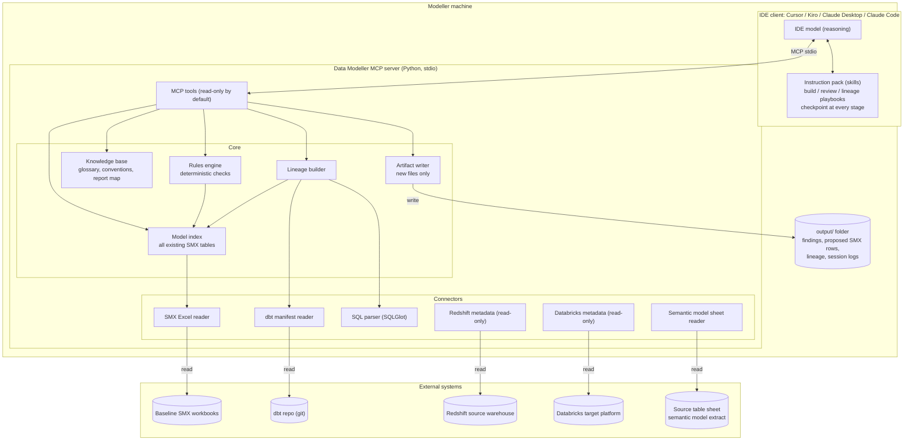
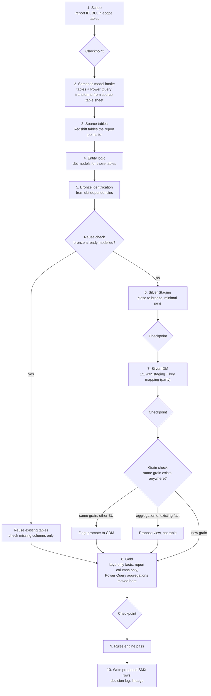
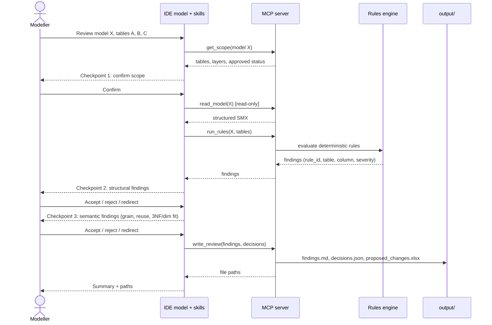
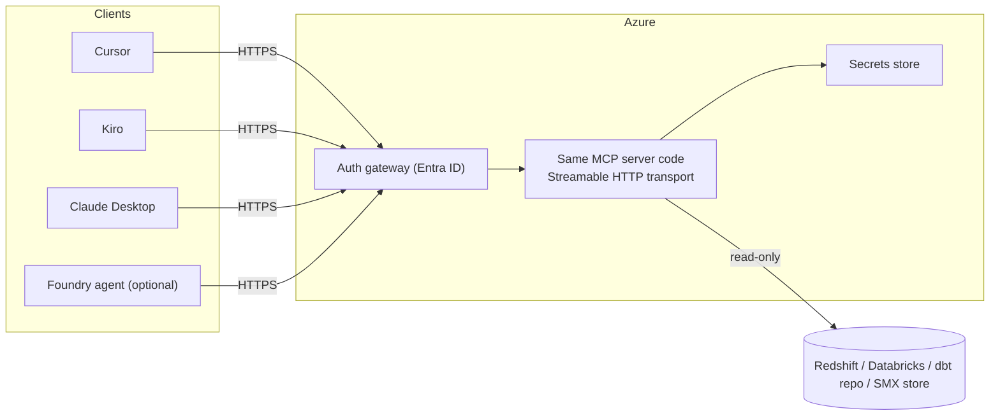

# Data Modeller Assistant: Architecture (v1)

v1 is local-first. The MCP server runs as a local stdio process on each modeller's machine, and reasoning uses the IDE's own model. The original Azure diagram is treated as a v2 option (Section 4), not the v1 design.

---

## 1. System overview

---

## 2. Build flow (per Power BI report)

Follows the process the architect described on Sept 17. Every stage ends with a human checkpoint.

---

## 3. Review session (sequence)

---

## 4. v2 option: hosted

Only if the team decides on hosting. The same tool and rules code is reused, exposed over Streamable HTTP. If a Foundry agent becomes a client, note that Foundry Agent Service only accepts remote MCP endpoints, and non-streaming MCP tool calls time out at 50 seconds.

---

## 5. Design rules

| Rule | Why |
|---|---|
| Deterministic checks live in code, not prompts | Repeatable, testable, auditable |
| The LLM handles judgement and explanation only | Grain, reuse and business meaning stay human + agent |
| Read-only credentials for every source system | Read-only is enforced, not just promised |
| Writer can only write inside `output/` | Baseline SMX is never overwritten |
| Every finding carries rule_id, table, column, severity, evidence | Fully traceable |
| Model index rebuilt from source at session start | Avoids stale reuse detection |
| One rules/KB repo shared by all IDEs | One source of truth |

---

## 6. Sources

- MCP transports and Python SDK: [MCP Python SDK](https://github.com/john0312/mcp-python-sdk)
- Kiro MCP (stdio + remote): [kiro.dev](https://kiro.dev/docs/mcp/index)
- Cursor MCP transports: [cursor.com](https://cursor.com/docs/mcp)
- Claude Desktop local servers: [guide](https://www.host-tracker.com/pt/learn/ai-assistants/connect-mcp-servers-to-claude-desktop)
- dbt lineage via manifest: [OpenMetadata](https://docs.open-metadata.org/connectors/ingestion/workflows/dbt/ingest-dbt-lineage)
- SQLGlot dialects and lineage: [SQLGlot](https://openapps.pro/packages/sqlglot)
- Foundry MCP limits: [Microsoft Learn](https://learn.microsoft.com/en-my/Azure/foundry-classic/agents/how-to/tools-classic/model-context-protocol)