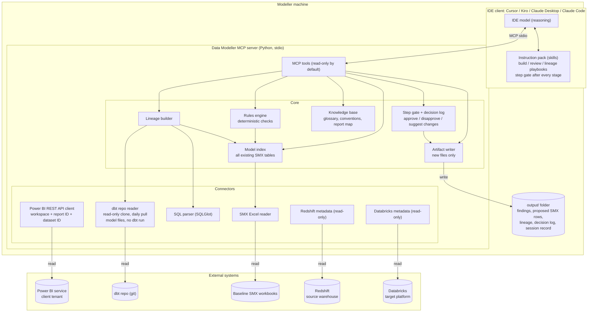
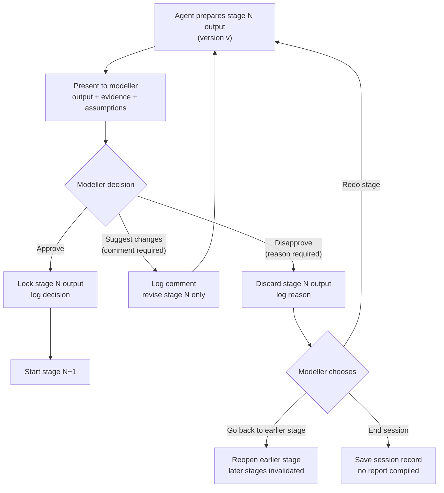
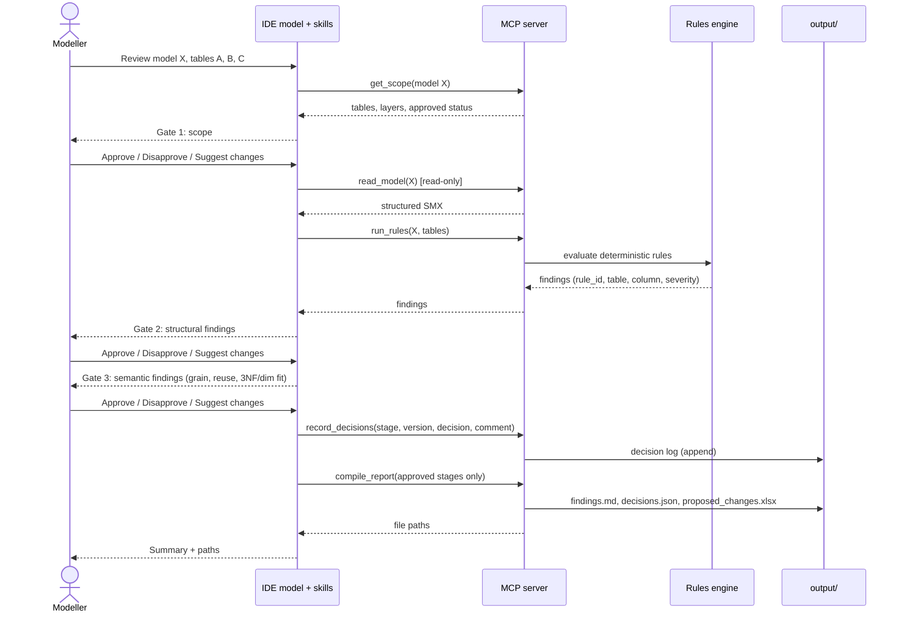
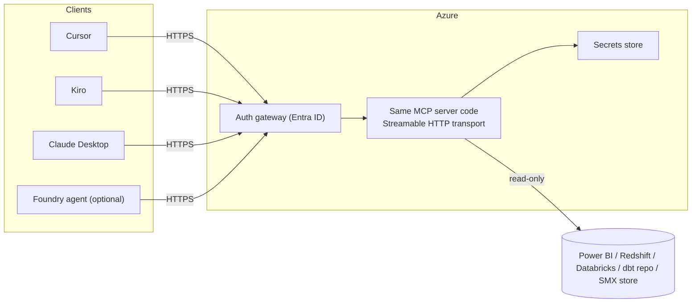

# Data Modeller MCP Tools: Architecture (v1)

v1 is local-first. The MCP server runs as a local `stdio` process on each modeller's machine, and reasoning uses the IDE's own model.

The agent is **not fully automated**. It prepares each step, and the modeller must **Approve**, **Disapprove** or **Suggest changes** before anything moves on (Section 3). What the agent may and may not do is defined in Section 7, **Limitations**.

The original Azure diagram is treated as a v2 option (Section 6), not the v1 design.

This document is the target design. The current prototype, which runs on sample data, is described separately in `PHASE_0_ARCH.md`.

---

## **1. System overview**

---

## **2. Power BI and dbt integration**

The architect's current script takes the report **name** as a parameter. The agent instead takes **IDs**, which are unique and stable:

| Input | Required | Why |
|---|---|---|
| Workspace ID (`groupId`) | Yes | All "In Group" endpoints are scoped to a workspace |
| Report ID | Yes | Identifies the report the modeller wants to analyse |
| Dataset ID | Optional | If given, it is checked against the report's own `datasetId`. A mismatch stops the session and asks the modeller |

### *2.1. Call plan*

| # | Call | Purpose | Notes |
|---|---|---|---|
| 1 | `GET /v1.0/myorg/groups/{groupId}/reports/{reportId}` | Report name, `datasetId`, web URL | Scope `Report.Read.All`. Paginated (RDL) reports have no dataset, so they are rejected |
| 2 | `GET /v1.0/myorg/groups/{groupId}/datasets/{datasetId}` | Confirm the semantic model exists, get its name and configuration | Shown to the modeller at the scope gate |
| 3 | `GET /v1.0/myorg/groups/{groupId}/datasets/{datasetId}/datasources` | Source systems behind the model (server, database), so source tables can be matched to Redshift later | Scope `Dataset.Read.All`. **VERIFY:** some docs state the caller needs write permission on the dataset |
| 4 | `POST /v1.0/myorg/groups/{groupId}/datasets/{datasetId}/executeQueries` | Run read-only DAX to list tables, columns and measures used by the report | Needs the tenant setting "Dataset Execute Queries REST API", plus dataset read and build permission. This classic endpoint supports DAX only: no MDX, INFO functions or DMV queries |
| 4b | "Execute DAX Queries In Group" (Arrow format) | Same as 4, but documented to support INFO functions, which can expose tables, columns, measures and partitions **VERIFY** before relying on it. Pro and PPU users are limited to 40 query requests per minute |

### *2.2. Getting Power Query (M) transforms*

The transforms are the hardest part to get through the REST API:

| Option | What it gives | Constraint |
|---|---|---|
| INFO functions via call 4b | Partition query definitions (M) | Pending verification |
| Scanner API (admin) | M expressions per table when `datasetExpressions` is on | Needs Power BI Service Admin or Fabric Admin, plus tenant settings |
| XMLA endpoint | Full model metadata | Needs PPU or a Premium / Fabric capacity. Pro is not enough |
| Source table sheet (`Reports_KPI_Details.csv`) | Per semantic model table: source tables, selected columns, transformations and the source query (SQL or M) | Fallback if none of the above is available (REQUIREMENTS D4) |

Recommendation: try 4b first. If it fails, use the sheet for M transforms and the REST API for everything else.

### *2.3. Authentication and limits*

- Use a delegated user token (the modeller's own sign-in) by default. Service principals need the tenant setting "Allow service principals to use Power BI APIs", and some operations are limited without Premium capacity.
- Classic executeQueries limits: one table per query, 100,000 rows or 1,000,000 values, 15 MB, and 120 requests per minute per user. The agent only needs metadata-sized results.

### *2.4. dbt repository (reference only)*

The dbt code is used to find existing logic, never to run anything (REQUIREMENTS D3).

| Step | What the agent does |
|---|---|
| Checkout | Keep a read-only clone of the dbt repo. Run `git pull --ff-only` at most once a day, at session start if the last pull is older than 24 hours |
| Model exists? | Look up the model by file name, or by `alias` in its config or YAML |
| If it exists | Read the raw SQL and YAML. Follow `ref()` to upstream models and `source()` to bronze tables. Replace Jinja calls with table names so SQLGlot can parse the logic. Use it as the reference for Silver Staging |
| If it does not | The modeller chooses: data analysis by the agent (result approved at its gate), or their own dbt or SQL code, parsed the same way |

Jinja and macros are never executed. Anything that cannot be resolved statically is marked unknown for the modeller.

---

## **3. Step gate: Approve / Disapprove / Suggest changes**

Every stage in Build, Review and Lineage ends at the same gate. The agent cannot continue past a gate on its own.

Rules:
- **Approve** locks the stage output. Later stages may only build on approved outputs.
- **Suggest changes** revises only the current stage, creating a new version. All earlier versions stay in the log.
- **Disapprove** needs a reason. Nothing from that version is used downstream.
- Every decision is logged with: stage, version, decision, comment or reason, user, timestamp.
- The **final report is compiled only from approved stages plus the decision log**. Disapproved and superseded versions appear in the log, not in the findings.
- Approving a stage is not approving the model. Final model approval stays with AGI reviewers, outside the tool.

---

## **4. Build flow (per Power BI report)**
Follows the original 14-step flow (2 Nov). Every stage ends at the step gate in Section 3. The three major gates are the ones the architect named: Bronze list (which tables are found, already modelled or missing), Silver schemas and Gold models (is the transform logic correct). Each stage output includes its derivation and design rationale.

```mermaid
flowchart TD
    A["1. Scope<br/>workspace, report and dataset IDs, BU"] --> G1{"Gate"}
    G1 --> B["2. Power BI intake (OG 1)<br/>report, dataset, datasources,<br/>tables, columns, measures, M"]
    B --> G2{"Gate"}
    G2 --> C["3. Requirements (OG 2)<br/>what the report does,<br/>which data it uses"]
    C --> G3{"Gate"}
    G3 --> D["4. Legacy entities (OG 3)<br/>every table the report uses<br/>and its source tables"]
    D --> G4{"Gate"}
    G4 --> E{"5. Bronze identification (OG 4)<br/>per table: dbt model?<br/>already in an SMX?"}
    E -->|"dbt model found"| E1["Bronze from<br/>ref() / source() chain"]
    E -->|"already modelled"| E2["Reuse, missing<br/>columns only"]
    E -->|"missing"| E3["Modeller chooses:<br/>data analysis (approve its result)<br/>or own dbt / SQL code"]
    E1 --> G5{"MAJOR GATE 1<br/>Bronze table list"}
    E2 --> G5
    E3 --> G5
    G5 --> P{"Permission to<br/>sample data?"}
    P -->|"granted"| F["6. Data extraction (OG 5.1)<br/>max 20 rows per Bronze table,<br/>data analysis"]
    P -->|"declined or not available"| FS["6. Data extraction skipped<br/>reason logged, metadata only"]
    F --> G6{"Gate"}
    FS --> G6
    G6 --> H["7. Reuse check (OG 6-7)<br/>already modelled: reuse, missing columns<br/>new: from dbt logic, data analysis<br/>or modeller-provided code"]
    H --> G7{"Gate"}
    G7 --> I["8. Silver Staging (OG 8)<br/>close to Bronze, minor cleanup"]
    I --> G8{"Gate"}
    G8 --> J["9. Silver IDM (OG 9)<br/>3NF, key mapping (party)"]
    J --> G9{"MAJOR GATE 2<br/>Silver schemas"}
    G9 --> K["10. Gold (OG 11-12)<br/>facts and dimensions, keys-only facts,<br/>report columns only, PQ aggregations here,<br/>grain check: CDM, view or new table"]
    K --> G10{"MAJOR GATE 3<br/>Gold models"}
    G10 --> L["11. Rules pass<br/>deterministic rules on the proposal"]
    L --> G11{"Gate"}
    G11 --> M["Write outputs (OG 14)<br/>data model XLSX, requirement document,<br/>report, decision log, lineage"]
```

---

## **5. Review session (sequence)**

---

## **6. `v2` option: hosted**
Only if the team decides on hosting. The same tool and rules code is reused, exposed over Streamable HTTP. If a Foundry agent becomes a client, note that Foundry Agent Service only accepts remote MCP endpoints, and non-streaming MCP tool calls time out at 50 seconds.

---

## **7. Limitations**

The agent is an assistant, not an autonomous modeller. This section is the contract for what it is allowed to do.

### *7.1. The agent MAY*

- Read Power BI report and semantic model metadata for the workspace, report and dataset IDs the modeller gives it.
- Run read-only DAX queries for metadata (tables, columns, measures).
- Read the dbt repository, SMX workbooks, the knowledge base, and Redshift and Databricks metadata.
- Propose: scope, a requirement document, legacy entities, bronze tables, Silver Staging, Silver IDM, Gold designs, findings and lineage.
- Sample up to 20 rows per approved Bronze table for data analysis, only with the modeller's separate permission (data extraction stage).
- Run the deterministic rules engine and report its findings.
- Revise a stage when the modeller suggests changes.
- Write new files to `output/` only, after the final gate is approved.

### *7.2. The agent MUST NOT*

- Move past any gate without an explicit Approve.
- Treat silence, an unclear answer or a partial answer as approval. It asks again.
- Change an approved stage without the modeller reopening it.
- Write to, refresh, publish to or modify anything in Power BI, the dbt repo, Redshift, Databricks or the baseline SMX.
- Run dbt commands (build, run, compile, test, docs generate) or execute Jinja from the dbt project. The repo is read as code only.
- Run data-returning queries beyond what metadata needs, except the data extraction stage: at most 20 rows per approved Bronze table, only after the modeller grants permission in that session, and only once the client has approved the access route. It never exports report data.
- Invent missing information: grain, BU, business meaning, M logic it could not read. It marks these as unknown and asks.
- Mark a model, table or finding as "approved by AGI". Final approval stays with human reviewers.
- Decide grain, reuse, CDM promotion or business meaning on its own. It proposes; the modeller decides.
- Compile the final report from disapproved or superseded versions.

### *7.3. Not in scope*

- End-to-end automation: there is no "run everything" mode.
- Approving models: final approval stays with AGI reviewers.

What Phase 0 leaves out is listed in `PHASE_0_ARCH.md`.

### *7.4. Known technical limitations*

| Area | Limitation | Impact |
|---|---|---|
| Power BI executeQueries (classic) | DAX only; no MDX, INFO functions or DMV queries | Model metadata via INFO needs the newer Arrow endpoint (pending verification) or another route |
| Power BI M transforms | Scanner API needs admin rights; XMLA needs PPU or Premium / Fabric capacity | May need the existing source table sheet as fallback |
| Power BI datasources call | May require write permission on the dataset (**VERIFY**) | Could block source discovery for read-only users |
| Power BI service principal | Needs a tenant setting; some operations are limited without Premium | Default to a delegated user token |
| Power BI rate limits | Classic executeQueries: 120 requests per minute per user; Arrow endpoint: 40 per minute on Pro / PPU | Metadata calls must be batched and cached per session |
| dbt read as code | Macros and custom Jinja are not executed, so some logic cannot be resolved statically | Unresolved parts are marked unknown for the modeller |
| SMX | No grain or BU column today (REQUIREMENTS Q3) | Grain and BU checks depend on that decision |
| LLM judgement | Semantic proposals can be wrong | This is why every stage has a gate |

---

## **8. Design rules**

| Rule | Why |
|---|---|
| Every stage ends at a step gate (approve / disapprove / suggest changes) | Not fully automated by design |
| Reports are identified by workspace, report and dataset IDs, not names | Unique, stable, unambiguous |
| Final report compiled only from approved stages | What ships is what the modeller signed off |
| Deterministic checks live in code, not prompts | Repeatable, testable, auditable |
| The LLM handles proposals and explanation only | Grain, reuse and business meaning stay human decisions |
| Read-only credentials for every source system | Read-only is enforced, not just promised |
| Writer can only write inside `output/` | Baseline SMX is never overwritten |
| Every finding carries rule_id, table, column, severity, evidence | Fully traceable |
| Model index rebuilt from source at session start | Avoids stale reuse detection |
| One rules/KB repo shared by all IDEs | One source of truth |

---

## **9. Sources**
- Power BI Get Report (returns `datasetId`): [Microsoft Learn](https://learn.microsoft.com/en-us/rest/api/power-bi/reports/get-report)
- Power BI Get Reports In Group: [Microsoft Learn](https://learn.microsoft.com/rest/api/power-bi/reports/get-reports-in-group)
- Power BI Execute Queries (limits, DAX only): [Microsoft Learn](https://learn.microsoft.com/rest/api/power-bi/datasets/execute-queries), [In Group](https://learn.microsoft.com/en-us/rest/api/power-bi/datasets/execute-queries-in-group)
- Power BI Execute DAX Queries In Group (Arrow, INFO functions): [Microsoft Learn](https://learn.microsoft.com/en-us/rest/api/power-bi/datasets/execute-dax-queries-in-group)
- Power BI Get Datasources In Group: [Microsoft Learn](https://learn.microsoft.com/en-us/rest/api/power-bi/datasets/get-datasources-in-group)
- Power BI Scanner API metadata: [SimplePBI notes](https://deepwiki.com/ladataweb/SimplePBI/2.1.2-scanner-api-and-metadata-collection)
- Power BI XMLA licensing: [Microsoft Learn](https://learn.microsoft.com/en-us/power-bi/service-premium-connect-tools), [Tabular Editor](https://docs.tabulareditor.com/en/tutorials/powerbi-xmla.html)
- Power BI Get Tables is push-dataset only: [Fabric community](https://community.fabric.microsoft.com/t5/Developer/Get-the-content-of-a-dataset-in-group/m-p/4593608)
- MCP transports and Python SDK: [MCP Python SDK](https://github.com/john0312/mcp-python-sdk)
- Kiro MCP (stdio + remote): [kiro.dev](https://kiro.dev/docs/mcp/index)
- Cursor MCP transports: [cursor.com](https://cursor.com/docs/mcp)
- Claude Desktop local servers: [guide](https://www.host-tracker.com/pt/learn/ai-assistants/connect-mcp-servers-to-claude-desktop)
- dbt lineage via manifest: [OpenMetadata](https://docs.open-metadata.org/connectors/ingestion/workflows/dbt/ingest-dbt-lineage)
- SQLGlot dialects and lineage: [SQLGlot](https://openapps.pro/packages/sqlglot)
- Foundry MCP limits: [Microsoft Learn](https://learn.microsoft.com/en-my/Azure/foundry-classic/agents/how-to/tools-classic/model-context-protocol)
