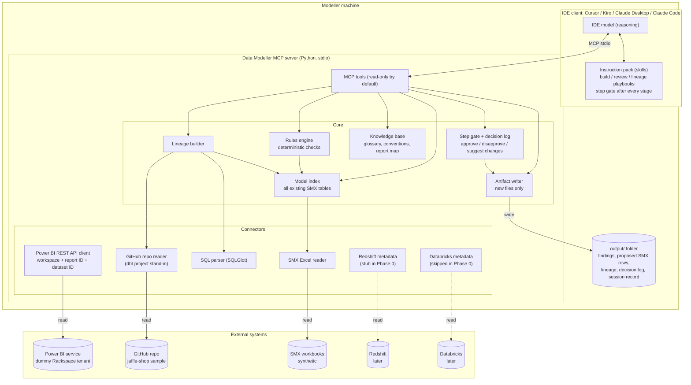
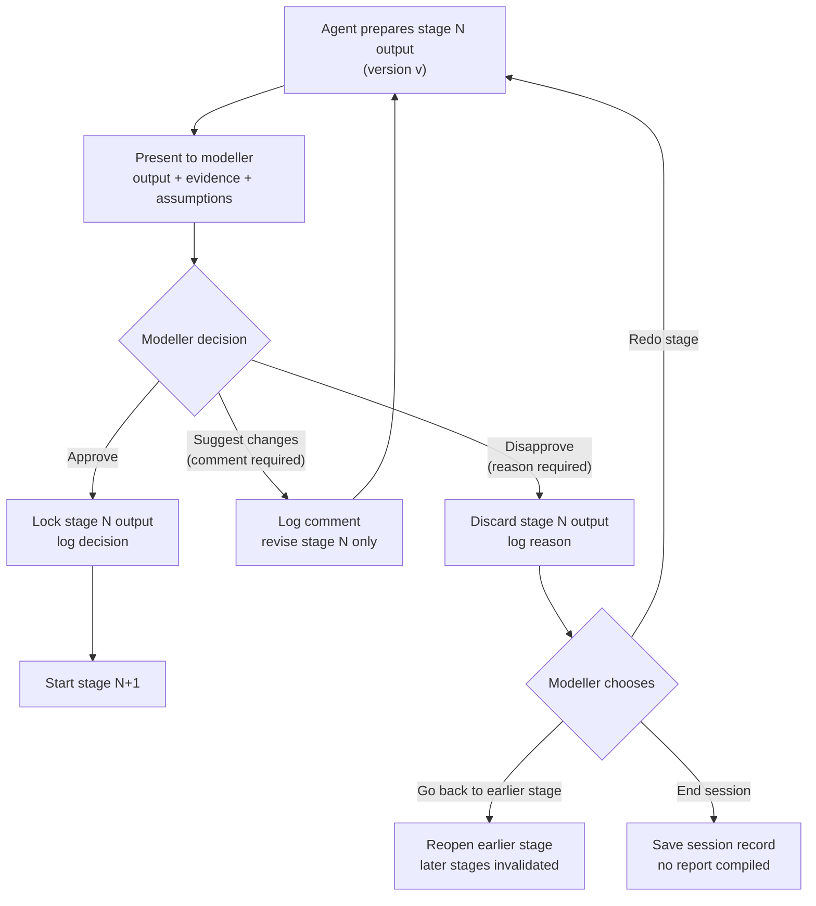
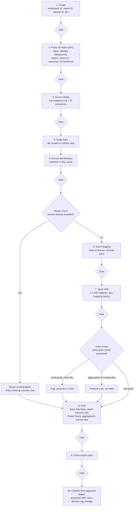
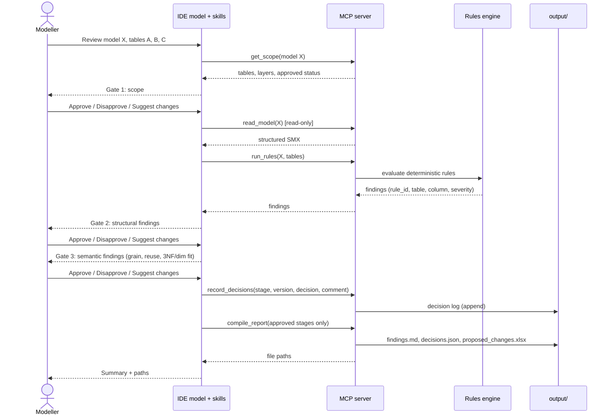
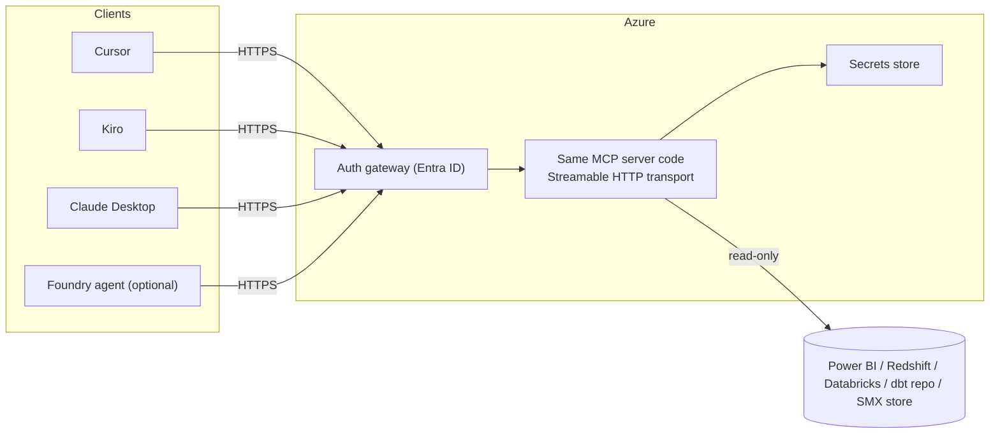

# Data Modeller MCP Tools: Architecture (v1)

v1 is local-first. The MCP server runs as a local `stdio` process on each modeller's machine, and reasoning uses the IDE's own model.

The agent is **not fully automated**. It prepares each step, and the modeller must **Approve**, **Disapprove** or **Suggest changes** before anything moves on (Section 3). What the agent may and may not do is defined in Section 7, **Limitations**.

The original Azure diagram is treated as a v2 option (Section 6), not the v1 design.

### Current phase: Phase 0 (prototype)

Phase 0 is a prototype on sample data, run before v1 formally starts. Nothing in Phase 0 touches client systems or data.

| System     | Production target                   | Phase 0, prototype (now)                                                                       |
| ---------- | ----------------------------------- | ---------------------------------------------------------------------------------------------- |
| Power BI   | Client tenant via Power BI REST API | Dummy Power BI account (Rackspace tenant), real REST API calls, sample report + semantic model |
| dbt        | Client dbt repo                     | Public GitHub repo standing in for dbt (suggested: `dbt-labs/jaffle-shop`)                   |
| Redshift   | Client source warehouse             | Source tables taken from the Power BI datasource info; Redshift connector stubbed              |
| Databricks | Client target platform              | **Skipped.** Gold is proposed as SMX rows only, not validated against a live target      |
| SMX        | Client workbooks                    | Synthetic SMX workbooks                                                                        |

---

## **1. System overview**

Dotted lines are not wired in Phase 0.

---

## **2. Power BI API integration**

The architect's current script takes the report **name** as a parameter. The agent instead takes **IDs**, which are unique and stable:

| Input                      | Required | Why                                                                                                                |
| -------------------------- | -------- | ------------------------------------------------------------------------------------------------------------------ |
| Workspace ID (`groupId`) | Yes      | All "In Group" endpoints are scoped to a workspace                                                                 |
| Report ID                  | Yes      | Identifies the report the modeller wants to analyse                                                                |
| Dataset ID                 | Optional | If given, it is checked against the report's own `datasetId`. A mismatch stops the session and asks the modeller |

### *2.1. Call plan*

| #  | Call                                                                      | Purpose                                                                                                        | Notes                                                                                                                                                                               |
| -- | ------------------------------------------------------------------------- | -------------------------------------------------------------------------------------------------------------- | ----------------------------------------------------------------------------------------------------------------------------------------------------------------------------------- |
| 1  | `GET /v1.0/myorg/groups/{groupId}/reports/{reportId}`                   | Report name, `datasetId`, web URL                                                                            | Scope `Report.Read.All`. Paginated (RDL) reports have no dataset, so they are rejected                                                                                            |
| 2  | `GET /v1.0/myorg/groups/{groupId}/datasets/{datasetId}`                 | Confirm the semantic model exists, get its name and configuration                                              | Shown to the modeller at the scope gate                                                                                                                                             |
| 3  | `GET /v1.0/myorg/groups/{groupId}/datasets/{datasetId}/datasources`     | Source systems behind the model (server, database), so source tables can be matched to Redshift later          | Scope `Dataset.Read.All`. **VERIFY:** some docs state the caller needs write permission on the dataset                                                                      |
| 4  | `POST /v1.0/myorg/groups/{groupId}/datasets/{datasetId}/executeQueries` | Run read-only DAX to list tables, columns and measures used by the report                                      | Needs the tenant setting "Dataset Execute Queries REST API", plus dataset read and build permission. This classic endpoint supports DAX only: no MDX, INFO functions or DMV queries |
| 4b | "Execute DAX Queries In Group" (Arrow format)                             | Same as 4, but documented to support INFO functions, which can expose tables, columns, measures and partitions | **VERIFY** on the dummy tenant before relying on it. Pro and PPU users are limited to 40 query requests per minute                                                            |

### *2.2. Getting Power Query (M) transforms*

The transforms are the hardest part to get through the REST API:

| Option                      | What it gives                                             | Constraint                                                         |
| --------------------------- | --------------------------------------------------------- | ------------------------------------------------------------------ |
| INFO functions via call 4b  | Partition query definitions (M)                           | Pending verification                                               |
| Scanner API (admin)         | M expressions per table when `datasetExpressions` is on | Needs Power BI Service Admin or Fabric Admin, plus tenant settings |
| XMLA endpoint               | Full model metadata                                       | Needs PPU or a Premium / Fabric capacity. Pro is not enough        |
| Existing source table sheet | What the team already extracted                           | Fallback if none of the above is available                         |

Recommendation: try 4b on the dummy tenant first. If it fails, use the sheet for M transforms and the REST API for everything else.

### *2.3. Dummy account setup (Phase 0)*

- One Rackspace Power BI workspace with a small sample report and semantic model. The sample model should sit on top of the same jaffle-shop data as the GitHub repo, so report, model and "dbt" logic line up end to end.
- Use a delegated user token (the modeller's own sign-in) first. Service principals need the tenant setting "Allow service principals to use Power BI APIs", and some operations are limited without Premium capacity.
- Classic executeQueries limits: one table per query, 100,000 rows or 1,000,000 values, 15 MB, and 120 requests per minute per user. The agent only needs metadata-sized results.

### *2.4. dbt stand-in (GitHub)*

- Repo: `dbt-labs/jaffle-shop`, dbt Labs' canonical sample project. The `jaffle_shop_duckdb` variant runs locally without a cloud warehouse, which makes generating `manifest.json` practical.
- Access: a local clone, or the GitHub Contents API with a token. Unauthenticated API calls are limited to 60 per hour per IP; a token raises this to 5,000.
- Bronze identification: use `manifest.json` dependencies when available, otherwise parse model SQL with SQLGlot.

---

## **3. Step gate: Approve / Disapprove / Suggest changes**

Every stage in Build, Review and Lineage ends at the same gate. The agent cannot continue past a gate on its own.

Rules:

- **Approve** locks the stage output. Later stages may only build on approved outputs.
- **Suggest changes** revises only the current stage, creating a new version. All earlier versions stay in the log.
- **Disapprove** needs a reason. Nothing from that version is used downstream.
- Every decision is logged with: stage, version, decision, comment or reason, user, timestamp.
- The **final report is compiled only from approved stages plus the decision log**. Disapproved and superseded versions appear in the log, not in the findings.
- Approving a stage is not approving the model. Final model approval stays with AGI reviewers, outside the tool.

---

## **4. Build flow (per Power BI report)**

Follows the process the architect described on Sept 17. Every "Gate" is the step gate in Section 3.

---

## **5. Review session (sequence)**

---

## **6. `v2` option: hosted**

Only if the team decides on hosting. The same tool and rules code is reused, exposed over Streamable HTTP. If a Foundry agent becomes a client, note that Foundry Agent Service only accepts remote MCP endpoints, and non-streaming MCP tool calls time out at 50 seconds.

---

## **7. Limitations**

The agent is an assistant, not an autonomous modeller. This section is the contract for what it is allowed to do.

### *7.1. The agent MAY*

- Read Power BI report and semantic model metadata for the workspace, report and dataset IDs the modeller gives it.
- Run read-only DAX queries for metadata (tables, columns, measures).
- Read the dbt project (GitHub stand-in), SMX workbooks, the knowledge base and, later, Redshift and Databricks metadata.
- Propose: scope, source tables, bronze tables, Silver Staging, Silver IDM, Gold designs, findings and lineage.
- Run the deterministic rules engine and report its findings.
- Revise a stage when the modeller suggests changes.
- Write new files to `output/` only, after the final gate is approved.

### *7.2. The agent MUST NOT*

- Move past any gate without an explicit Approve.
- Treat silence, an unclear answer or a partial answer as approval. It asks again.
- Change an approved stage without the modeller reopening it.
- Write to, refresh, publish to or modify anything in Power BI, the dbt or GitHub repo, Redshift, Databricks or the baseline SMX.
- Run data-returning queries beyond what metadata needs. It does not export report data.
- Invent missing information: grain, BU, business meaning, M logic it could not read. It marks these as unknown and asks.
- Mark a model, table or finding as "approved by AGI". Final approval stays with human reviewers.
- Decide grain, reuse, CDM promotion or business meaning on its own. It proposes; the modeller decides.
- Compile the final report from disapproved or superseded versions.

### *7.3. Not in scope (Phase 0)*

- Databricks: no target validation, no table creation, no reconciliation of Gold output with the semantic model.
- Redshift: no live metadata; source tables come from Power BI datasource info.
- Real client data or tenants: dummy Rackspace Power BI account, public GitHub repo and synthetic SMX only.
- End-to-end automation: there is no "run everything" mode.

### *7.4. Known technical limitations*

| Area                              | Limitation                                                                                           | Impact                                                                                         |
| --------------------------------- | ---------------------------------------------------------------------------------------------------- | ---------------------------------------------------------------------------------------------- |
| Power BI executeQueries (classic) | DAX only; no MDX, INFO functions or DMV queries                                                      | Model metadata via INFO needs the newer Arrow endpoint (pending verification) or another route |
| Power BI M transforms             | Scanner API needs admin rights; XMLA needs PPU or Premium / Fabric capacity                          | May need the existing source table sheet as fallback                                           |
| Power BI datasources call         | May require write permission on the dataset (**VERIFY**)                                       | Could block source discovery for read-only users                                               |
| Power BI service principal        | Needs a tenant setting; some operations are limited without Premium                                  | Phase 0 uses a delegated user token                                                            |
| Power BI rate limits              | Classic executeQueries: 120 requests per minute per user; Arrow endpoint: 40 per minute on Pro / PPU | Metadata calls must be batched and cached per session                                          |
| GitHub                            | 60 unauthenticated API requests per hour per IP                                                      | Use a token or a local clone                                                                   |
| dbt stand-in                      | A public sample repo, not the client's dbt logic                                                     | Bronze mapping proves the mechanism, not client correctness                                    |
| SMX                               | No grain or BU column today (REQUIREMENTS Q3)                                                        | Grain and BU checks depend on that decision                                                    |
| LLM judgement                     | Semantic proposals can be wrong                                                                      | This is why every stage has a gate                                                             |

---

## **8. Design rules**

| Rule                                                                     | Why                                                    |
| ------------------------------------------------------------------------ | ------------------------------------------------------ |
| Every stage ends at a step gate (approve / disapprove / suggest changes) | Not fully automated by design                          |
| Reports are identified by workspace, report and dataset IDs, not names   | Unique, stable, unambiguous                            |
| Final report compiled only from approved stages                          | What ships is what the modeller signed off             |
| Deterministic checks live in code, not prompts                           | Repeatable, testable, auditable                        |
| The LLM handles proposals and explanation only                           | Grain, reuse and business meaning stay human decisions |
| Read-only credentials for every source system                            | Read-only is enforced, not just promised               |
| Writer can only write inside `output/`                                 | Baseline SMX is never overwritten                      |
| Every finding carries rule_id, table, column, severity, evidence         | Fully traceable                                        |
| Model index rebuilt from source at session start                         | Avoids stale reuse detection                           |
| One rules/KB repo shared by all IDEs                                     | One source of truth                                    |

---

## **9. Sources**

- Power BI Get Report (returns `datasetId`): [Microsoft Learn](https://learn.microsoft.com/en-us/rest/api/power-bi/reports/get-report)
- Power BI Get Reports In Group: [Microsoft Learn](https://learn.microsoft.com/rest/api/power-bi/reports/get-reports-in-group)
- Power BI Execute Queries (limits, DAX only): [Microsoft Learn](https://learn.microsoft.com/rest/api/power-bi/datasets/execute-queries), [In Group](https://learn.microsoft.com/en-us/rest/api/power-bi/datasets/execute-queries-in-group)
- Power BI Execute DAX Queries In Group (Arrow, INFO functions): [Microsoft Learn](https://learn.microsoft.com/en-us/rest/api/power-bi/datasets/execute-dax-queries-in-group)
- Power BI Get Datasources In Group: [Microsoft Learn](https://learn.microsoft.com/en-us/rest/api/power-bi/datasets/get-datasources-in-group)
- Power BI Scanner API metadata: [SimplePBI notes](https://deepwiki.com/ladataweb/SimplePBI/2.1.2-scanner-api-and-metadata-collection)
- Power BI XMLA licensing: [Microsoft Learn](https://learn.microsoft.com/en-us/power-bi/service-premium-connect-tools), [Tabular Editor](https://docs.tabulareditor.com/en/tutorials/powerbi-xmla.html)
- Power BI Get Tables is push-dataset only: [Fabric community](https://community.fabric.microsoft.com/t5/Developer/Get-the-content-of-a-dataset-in-group/m-p/4593608)
- dbt jaffle-shop sample: [GitHub](https://www.github.com/dbt-labs/jaffle-shop), [dbt docs](https://docs.getdbt.com/guides/clone-jaffle-shop.md)
- GitHub rate limits: [summary](https://moltchat-agent-commons.onrender.com/wiki/GitHub_REST_API_rate_limits_unauthenticated_vs_token.md)
- MCP transports and Python SDK: [MCP Python SDK](https://github.com/john0312/mcp-python-sdk)
- Kiro MCP (stdio + remote): [kiro.dev](https://kiro.dev/docs/mcp/index)
- Cursor MCP transports: [cursor.com](https://cursor.com/docs/mcp)
- Claude Desktop local servers: [guide](https://www.host-tracker.com/pt/learn/ai-assistants/connect-mcp-servers-to-claude-desktop)
- dbt lineage via manifest: [OpenMetadata](https://docs.open-metadata.org/connectors/ingestion/workflows/dbt/ingest-dbt-lineage)
- SQLGlot dialects and lineage: [SQLGlot](https://openapps.pro/packages/sqlglot)
- Foundry MCP limits: [Microsoft Learn](https://learn.microsoft.com/en-my/Azure/foundry-classic/agents/how-to/tools-classic/model-context-protocol)
